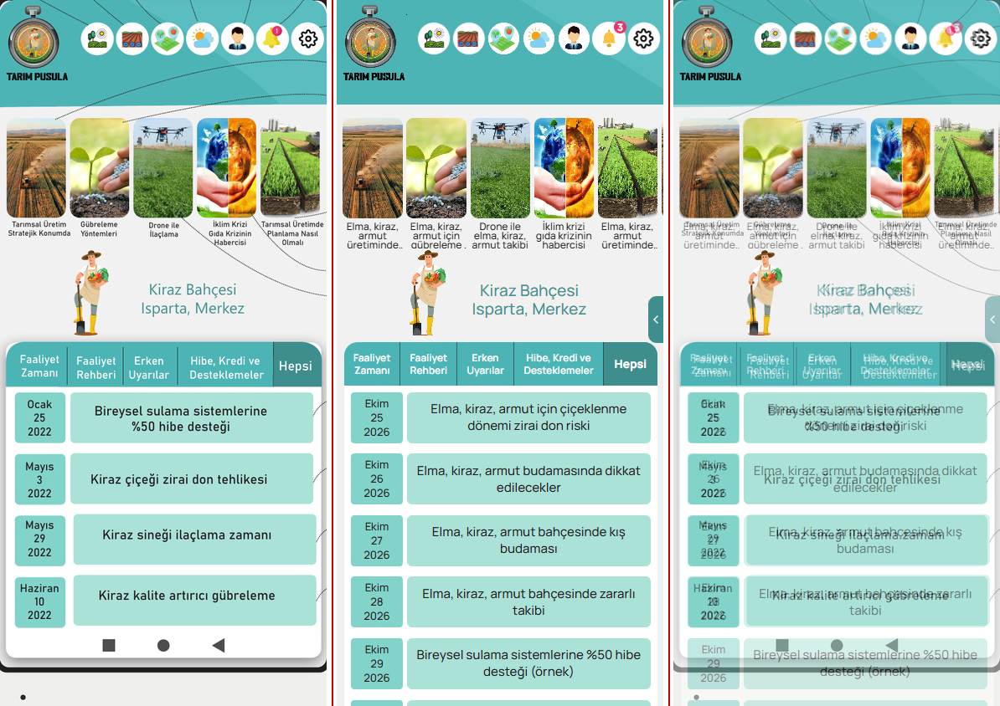
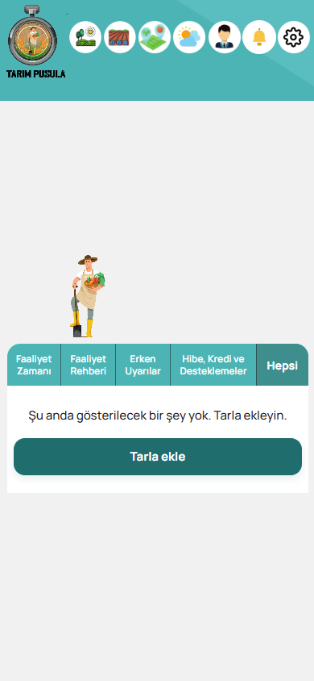

# Ana sayfa: hedef ile fark raporu (G22, G23 güncellemesi)

> **G23 (26 Ekim 2026, Mustafa'nın isteği):** ikonlar 39,6 → 42 px, slayt kartları 71x119,5 → 76x136 px
> büyütüldü; sağ kenar menüsü ve "Dikkat" rozeti kaldırıldı. Amblem ve bant hedefteki gibi kalır; çiftçi,
> sekmeli kart ve satırlar kart büyümesi kadar (17,2 px) aşağıdadır. e2e ölçüm testi yeni değerleri denetler
> (2 px üstü sapma kırmızı). Aşağıdaki G22 tablosu hedefle birebir karşılaştırmadır.

Hedef: `docs/referans/anasayfa_hedef.png`. Telefon ekranının içi x 322..951 (630 px) ve y 376'dan başlar; 390 px genişliğe ölçeklenir (ölçek 390 / 630 = 0,619).
Uygulama: `anasayfa_390x844.png` (Playwright, `apps/e2e/tests/g22.spec.ts`; her e2e koşusunda yeniden üretilir).

## Yan yana

Sol: hedef (ekran içi, 390x844'e ölçeklenmiş). Orta: uygulama. Sağ: ikisinin %50 bindirmesi; hizalama farkı çift görüntü olarak görünür.

Boş durum (arazi yokken): 

## Ölçüm yöntemi

1. Hedef görselde öğeler piksel örneklemesiyle bulundu (Python/Pillow): turkuaz bant rengi `#4DB4B5` sınırları, beyaz ikon dairelerinin yatay dizileri, kart görsellerinin beyaz olmayan sütunları, çiftçinin saydam olmayan kutusu, sekme başlığının turkuaz alanı, tarih kutusunun `#82D4CA` alanı.
2. Amblem: hedefteki "TARIM PUSULA" yazısının genişliği (118 px) ile `images/amblem.png` içindeki aynı yazının genişliği (322 px) oranlanarak görselin hedefteki boyu bulundu: 77 x 97 (genişliğin %19,7'si).
3. Değerler `apps/mobile/src/home/HomeParts.tsx` içindeki `HOME_LAYOUT` sabitindedir; ekran genişliğiyle orantılı ölçeklenir (en çok 430 px).
4. e2e testi uygulamadaki kutuları `boundingBox` ile ölçer, hedefle karşılaştırır; herhangi bir kenarda sapma 2 px veya üstüyse test kırmızı olur. Tablo testten otomatik üretilir:

## Ölçü tablosu (390x844, birim px)

Kaynak: [anasayfa_olcum.generated.md](anasayfa_olcum.generated.md) (son e2e koşusu). Son koşuda en büyük sapma 0,3 px.

| Öğe                                 | Hedef (x, y, g x y)       | Oran / not                  |
| ----------------------------------- | ------------------------- | --------------------------- |
| Üst bant yüksekliği                 | 125                       | bant altı y = 125           |
| Amblem (yazı dahil)                 | 6,7, 2,8, 77 x 97         | genişliğin %19,7'si         |
| İkon dairesi                        | çap 39,6, aralık 41,8     | genişliğin %10,2'si         |
| İkon 1 / İkon 7                     | x 96,6 / 347,3, y 26,6    | sağ boşluk 3,7              |
| Kart görseli                        | 71,2 x 119,5, aralık 4,9  | 74x122 oranı (0,60)         |
| Kart şeridi üst boşluğu             | 16,1 (bant altından)      | kart üstü y = 141,1         |
| Çiftçi                              | 84,3, 296,9, 53 x 104     | şeffaf PNG                  |
| Arazi adı bloğu                     | merkez x 230, üst y 338,6 | iki satır, turkuaz          |
| Sekme başlığı                       | 8,7, 408,6, 373,9 x 52,6  | sol 8,7 / sağ 7,4 boşluk    |
| 1. satır tarih kutusu               | 17,3, 468,6, 61,3 x 61    | satır aralığı 12,6          |

## Renkler (hedefte örneklenen = uygulama)

| Öğe                     | Hedef   | Uygulama |
| ----------------------- | ------- | -------- |
| Üst bant / sekme şeridi | #4DB4B5 | #4DB4B5  |
| Bant açık bölgesi       | #5ABDBF | #5ABDBF  |
| Satır metin kutusu      | #AAE2D8 | #AAE2D8  |
| Tarih kutusu            | #82D4CA | #82D4CA  |
| Sayfa zemini            | #F1F1F2 | #F1F1F2  |
| Seçili sekme (Hepsi)    | #3D8E8D | #3D8E8D  |

## Bilinen farklar (kasıtlı)

- **Kart başlığı yazısı 12 px** (hedefte ~9 px): erişilebilirlik alt sınırı 12 px (`g14` testi). 3 satırı aşan başlık "..." ile kısalır; tamamı karta dokununca detayda.
- **Zil ikonu SVG:** `images/ikon_bildirim.png` hedeften kesildiği için içinde sabit "1" rozeti var. Yanlış sayı göstermemek için zil çizgi SVG ile çizilir, gerçek okunmamış sayısı ayrı rozetle gösterilir.
- **Satır metinleri ve tarihler:** hedefteki metinler demo örneğidir; uygulamada satırlar arazinin ürününe göre gelir (demo'da `data/ornek_icerik`, gerçek modda yalnız onaylı veri).
- **Ekran oranı:** hedef ekran 630x1270 oranında, uygulama 390x844 (gerçek telefon oranı); bu yüzden ilk ekranda hedeften bir satır az görünür.
- Alt üç tuş telefonun sistem çubuğudur; yapılmadı. Oklar ve dış etiketler yapılmadı.
- Sağ kenar menü tutamacı ve "Dikkat" rozeti hedefte yoktur; şartname gereği eklendi (rozet yalnız onaylı aktif uyarıda görünür).
- Demo derlemesinde "Örnek veri" rozeti bandın sağ altında durur (yerleşimi kaydırmaz).
