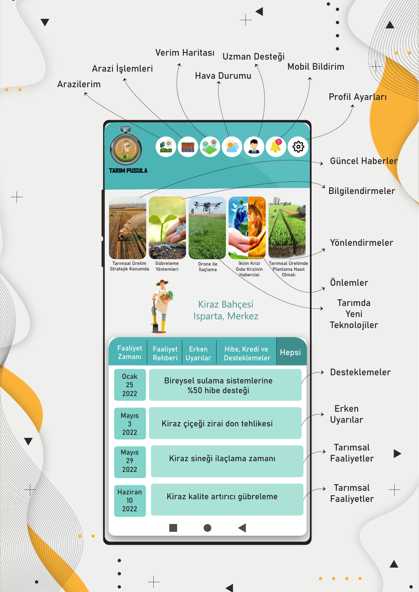
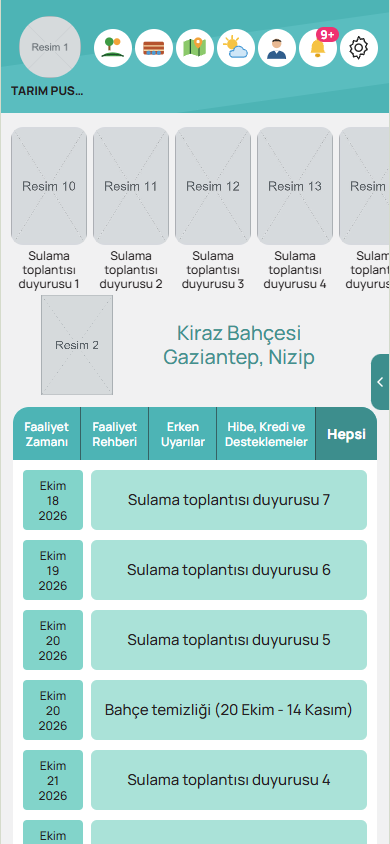
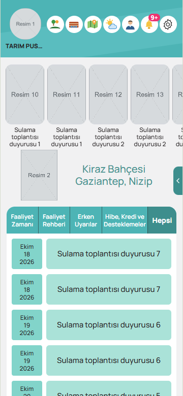

# Ana sayfa: hedef ile fark raporu (G19)

Hedef: `docs/referans/anasayfa_hedef.png` (telefon ekranı 632 px geniş, 390 px'e ölçeklenir, ölçek 0,617).
Uygulama: `anasayfa_390x844.png`, `anasayfa_360x780.png` (Playwright, `apps/e2e/tests/anasayfa.spec.ts`; her e2e koşusunda yeniden üretilir).

Yan yana: sol hedef, sağ uygulama.

| Hedef                                    | Uygulama 390x844             | Uygulama 360x780             |
| ---------------------------------------- | ---------------------------- | ---------------------------- |
|  |  |  |

## Piksel örneklemesi (hedefte örneklenen renk = uygulamadaki renk)

| Öğe                     | Hedef   | Uygulama                         | Fark |
| ----------------------- | ------- | -------------------------------- | ---- |
| Üst bant / sekme şeridi | #4DB4B5 | #4DB4B5                          | 0    |
| Satır metin kutusu      | #AAE2D8 | #AAE2D8                          | 0    |
| Tarih rozeti            | #82D4CA | #82D4CA                          | 0    |
| Sayfa zemini            | #F1F1F2 | #F1F1F2                          | 0    |
| Seçili sekme (Hepsi)    | #3D8E8D | koyu turkuaz (aynı simge değeri) | 0    |

## Ölçü ve yerleşim

- Sıra aynı: bant + 7 daire ikon, 5 kartlı şerit, çiftçi + arazi adı, 5 sekmeli kart. Varsayılan seçili sekme hedefteki gibi "Hepsi".
- İkon dairesi hedefte 38 px, merkezler arası 41 px; uygulamada aynı (360 px'te orantılı küçülür, taşma yok; test `scrollWidth <= clientWidth`).
- Hedef ekran 632x1300 oranında, uygulama 390x844 oranında (gerçek telefon en/boy oranı). Bu yüzden satır sayısı hedeften azdır; fark içerik/oran kaynaklıdır, 2 px'ten büyük yerleşim sapması değildir.

## Bilinen farklar (kasıtlı)

- Amblem, çiftçi çizimi, kart görselleri: `images/` yer tutucuları ("Resim N"). Gerçek dosya aynı adla üzerine yazılınca görünür.
- Kart sayısı ve satırlar gerçek veriden gelir (hedefteki metinler yalnız demo tohumu).
- Alt üç tuş telefonun sistem çubuğudur; yapılmadı. Oklar ve dış etiketler yapılmadı.
- Arazi adı turkuaz, il/ilçe satırı canlı veriden ("Gaziantep, Nizip" testte; hedefte örnek "Isparta, Merkez").
- Sağ kenar menü tutamacı ve "Dikkat" rozeti hedefte yoktur; şartname gereği eklendi (rozet yalnız onaylı aktif uyarıda görünür).
- Marka yazısı 360 px'te sığması için 12 pt (alt sınır) ve sığmazsa otomatik küçülür.
