# Görsel karşılaştırma (G16)

Üreten: `apps/e2e/tests/zgorsel.spec.ts` (Playwright, 390×844). Sol sütun yeni uygulamanın ekran görüntüsü,
sağ sütun eski uygulamanın referans slaydı (docs/referans). Ölçülen kurallar testte: Bugün'de kaydırmadan ≥ 6 liste satırı,
tüm dokunma hedefleri ≥ 44 px, düğmelerin etiketi var, ana içerik kullanılabilir alanın ≥ %70'ini doldurur.
Renkler ve yoğunluk: docs/TASARIM_REFERANSI.md.

| Ekran | Yeni uygulama | Eski uygulama (referans) |
| --- | --- | --- |
| Bugün (ana ekran) | 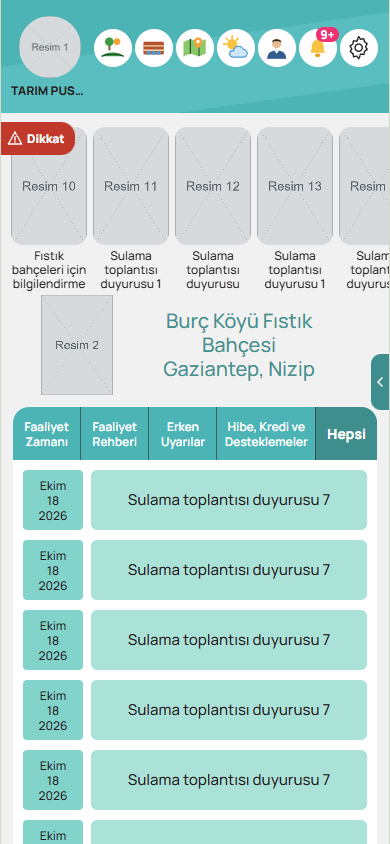 | 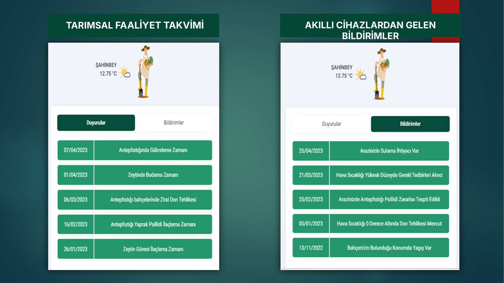 Duyurular / Bildirimler, tarih kutulu yeşil satırlar |
| Arazi İşlemleri | 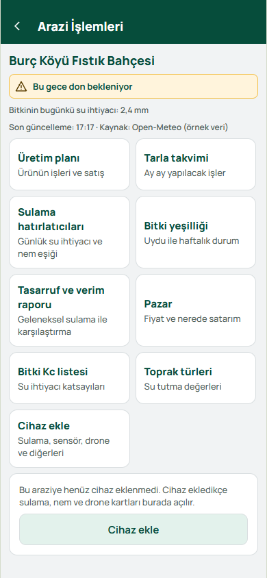 | Eski uygulamada karşılığı yok; aynı tema (renk, yoğunluk) uygulandı. |
| Hava Durumu | 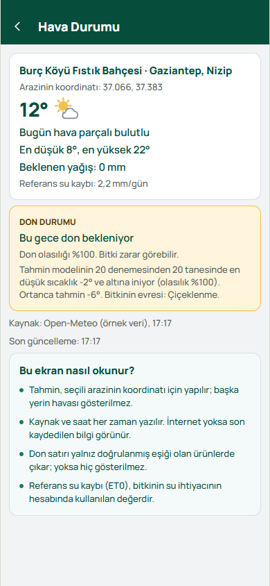 | Eski uygulamada karşılığı yok; aynı tema (renk, yoğunluk) uygulandı. |
| Bildirimler | 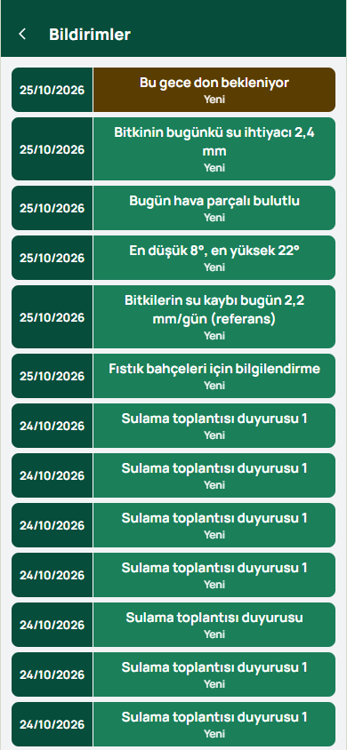 | Eski uygulamada karşılığı yok; aynı tema (renk, yoğunluk) uygulandı. |
| Tarlalarım (liste) | 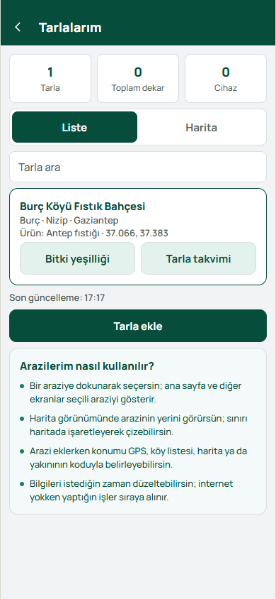 | 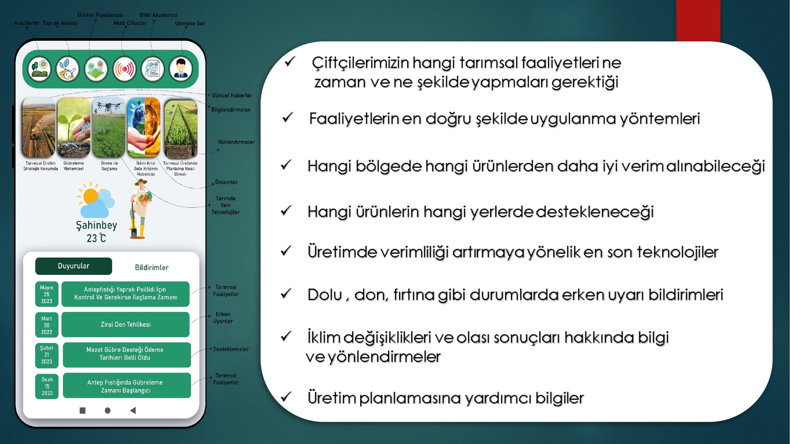 Ana ekran şeması, 6 özellik |
| Tarla ekle (4 konum yolu) | 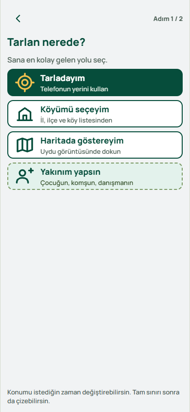 | Eski uygulamada karşılığı yok; aynı tema (renk, yoğunluk) uygulandı. |
| Takvim | 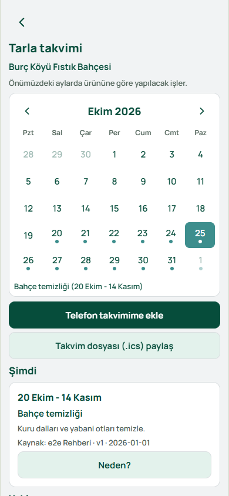 |  Ana ekran şeması, 6 özellik |
| Sulama | 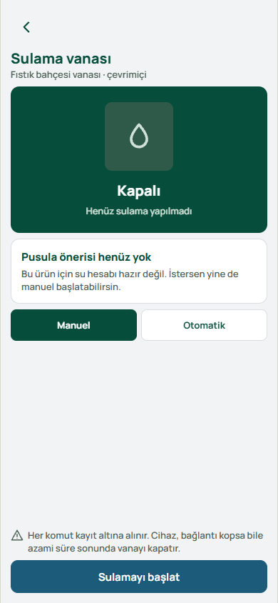 | Eski uygulamada karşılığı yok; aynı tema (renk, yoğunluk) uygulandı. |
| Soru sor (Pusula AI) | 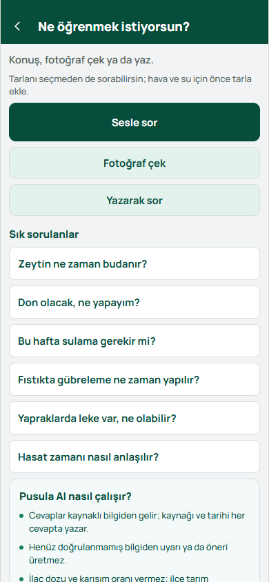 | Eski uygulamada karşılığı yok; aynı tema (renk, yoğunluk) uygulandı. |
| Pazar | 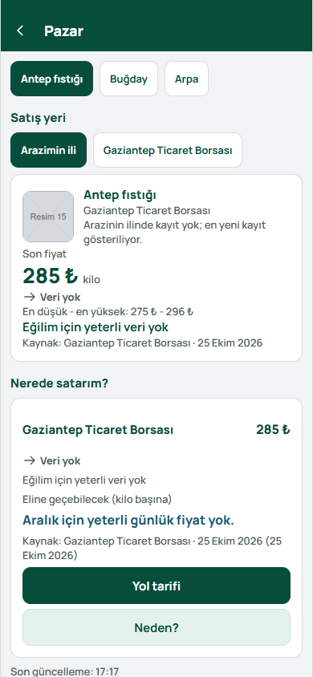 | Eski uygulamada karşılığı yok; aynı tema (renk, yoğunluk) uygulandı. |
| Bitki sağlığı (NDVI) | 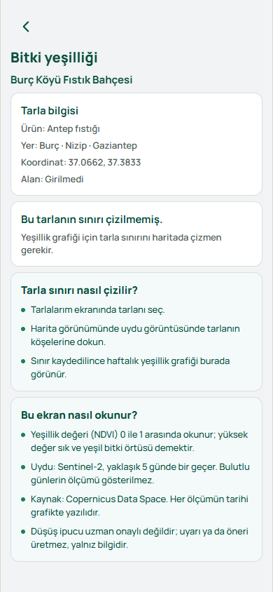 |  Ana ekran şeması, 6 özellik |
| Veri cüzdanı | 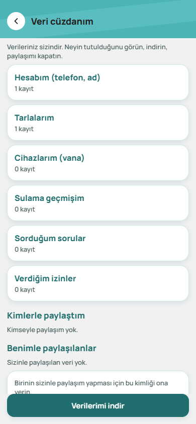 | Eski uygulamada karşılığı yok; aynı tema (renk, yoğunluk) uygulandı. |
| Giriş | 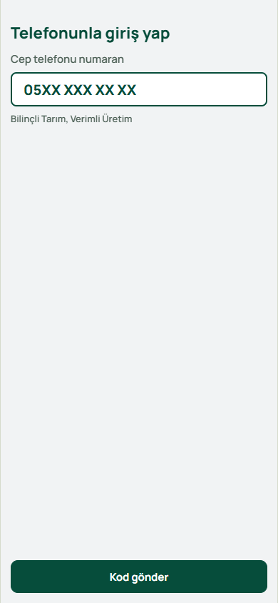 | Eski uygulamada karşılığı yok; aynı tema (renk, yoğunluk) uygulandı. |
| Ayarlar | 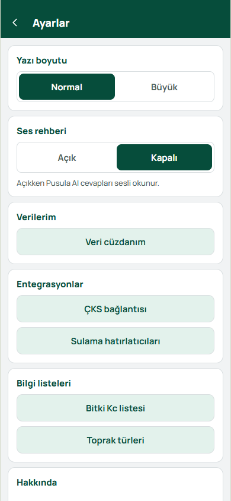 | Eski uygulamada karşılığı yok; aynı tema (renk, yoğunluk) uygulandı. |
| Bitki türü ve Kc listesi | 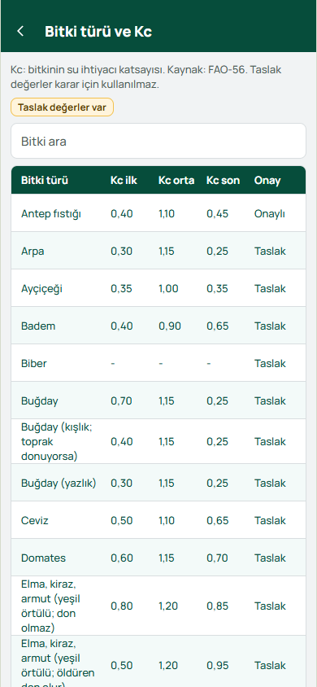 |  Kc ve toprak listeleri |
| Toprak türleri | 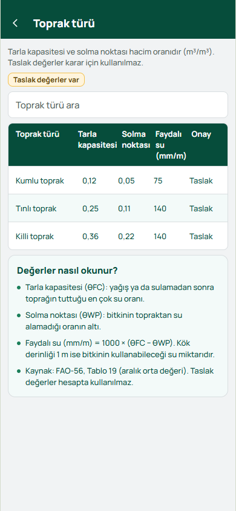 |  Kc ve toprak listeleri |
