# Panel görsel karşılaştırma (G17)

Üreten: `apps/e2e/tests/panel-akis.spec.ts` (Playwright, 1280×800). Referans: eski uygulamanın yönetim paneli
(docs/referans/eski_uygulama_slayt10.jpg, slayt12.jpg): solda koyu yeşil (#064D3B) kenar menü, üstte breadcrumb,
beyaz form/tablo kartları, etiketli sıkı alanlar, sağ-altta eylem düğmeleri.

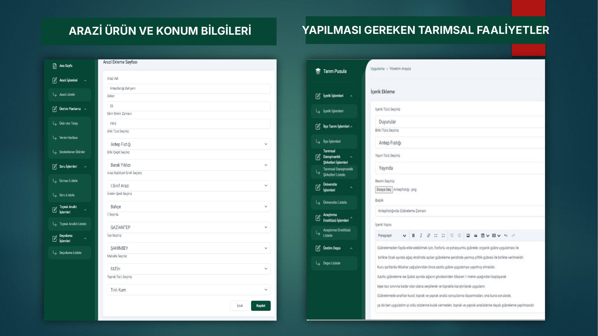
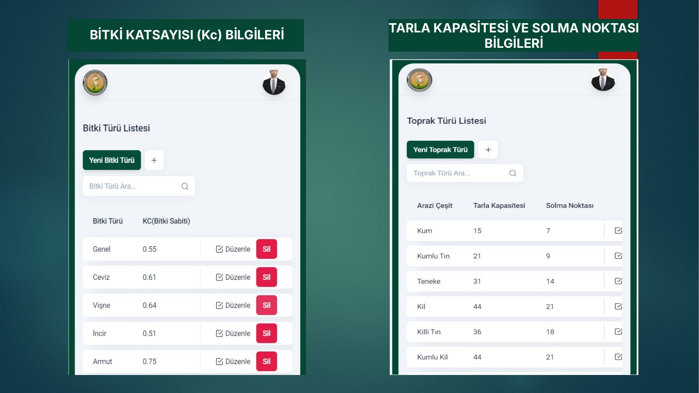

| Ekran | Yeni panel |
| --- | --- |
| Ana sayfa (özet kartları + son işlemler) | 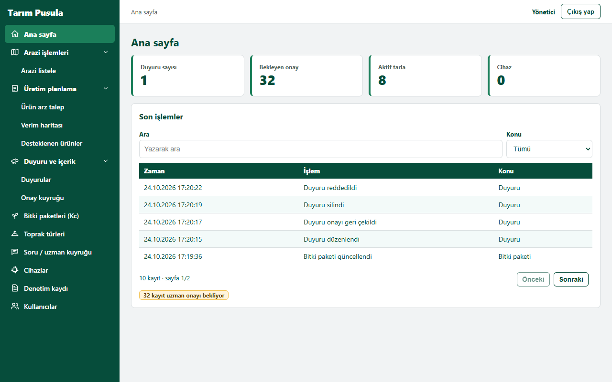 |
| Arazi listele | 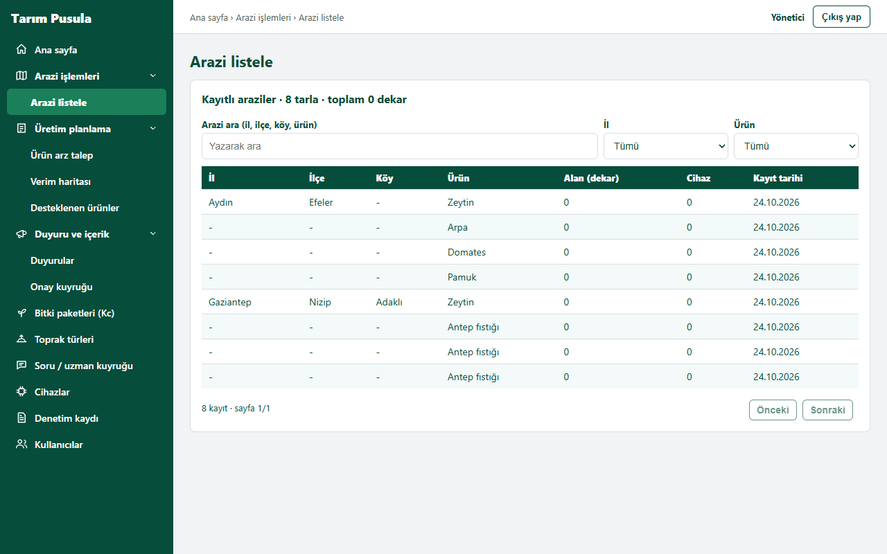 |
| Ürün arz talep | 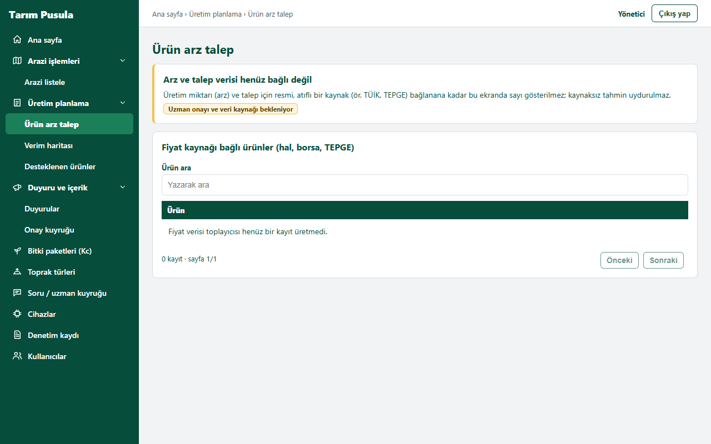 |
| Verim haritası | 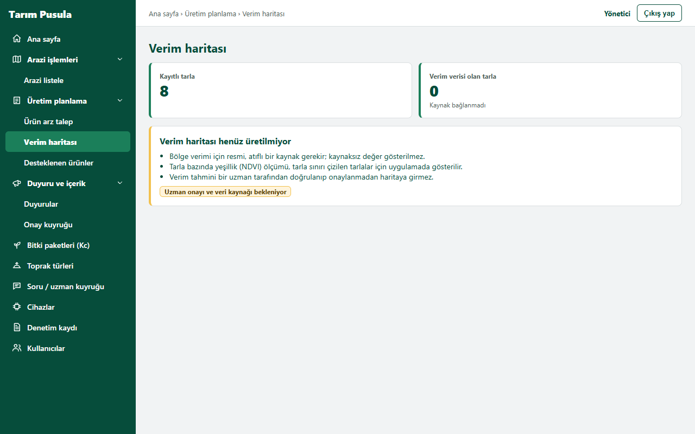 |
| Desteklenen ürünler | 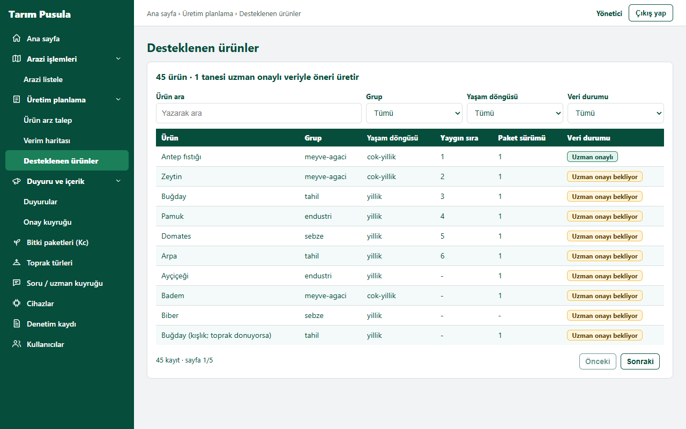 |
| Duyurular (form + önizleme + liste) | 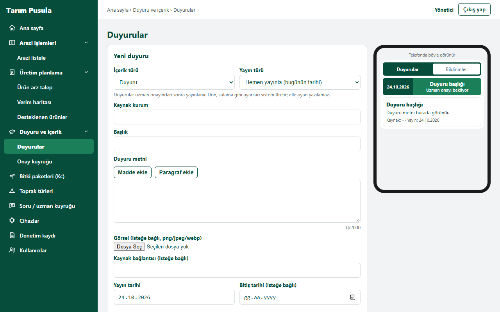 |
| Onay kuyruğu | 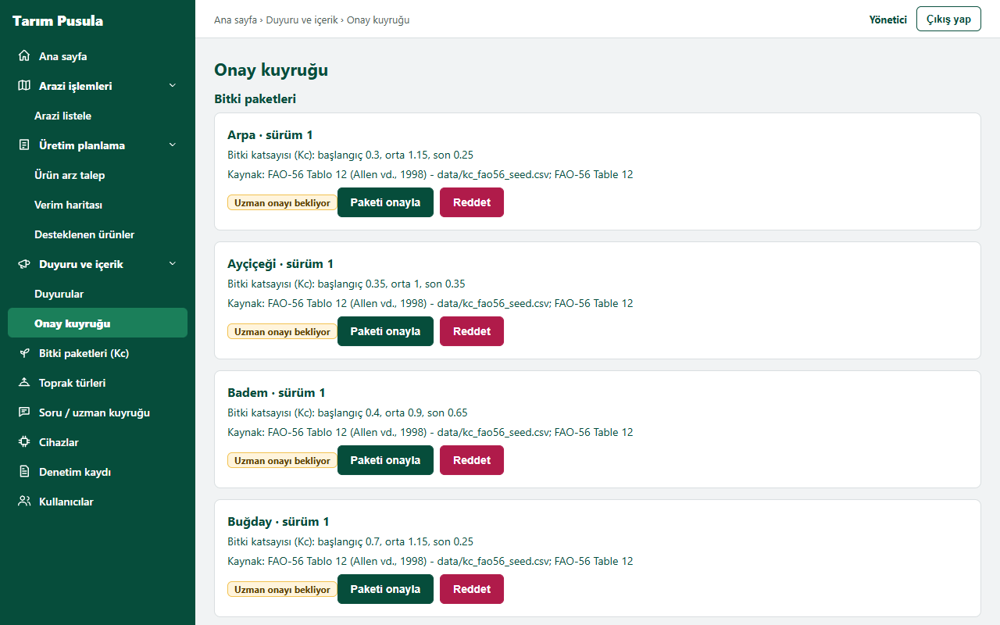 |
| Bitki paketleri (Kc) | 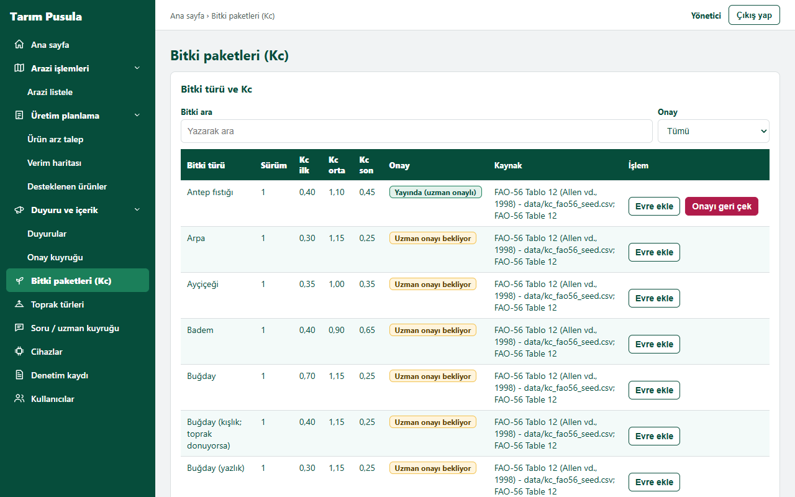 |
| Toprak türleri | 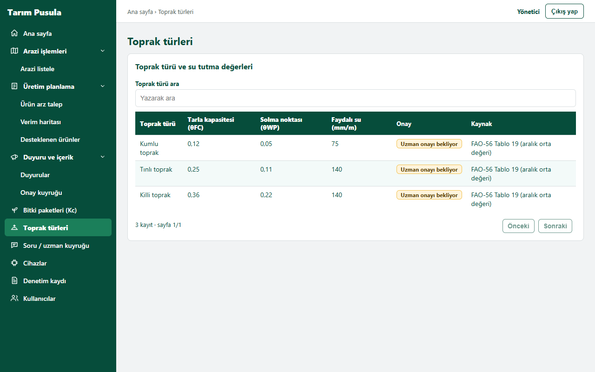 |
| Soru / uzman kuyruğu | 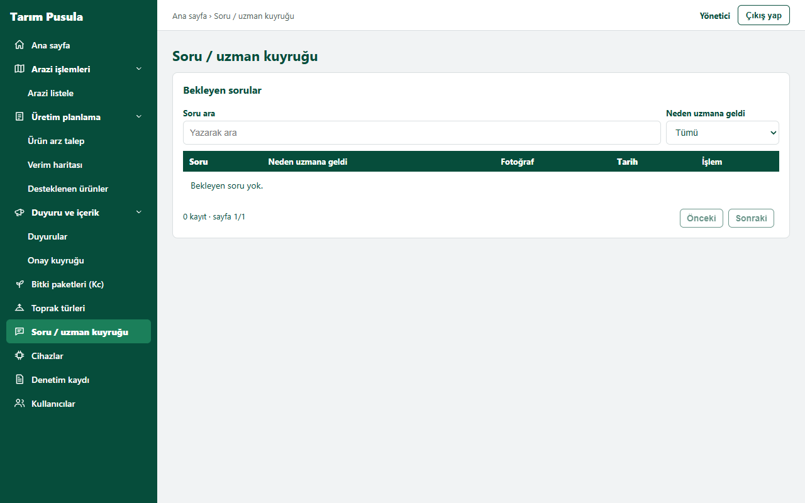 |
| Cihazlar | 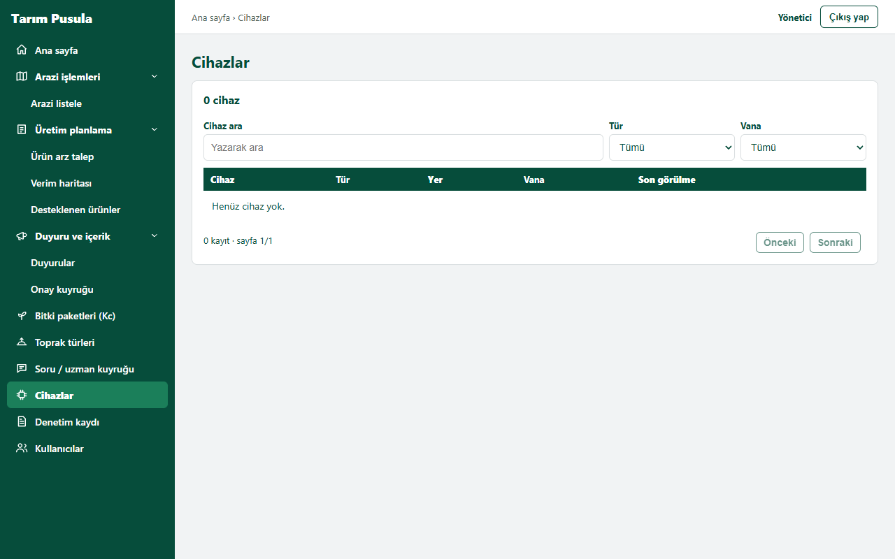 |
| Denetim kaydı | 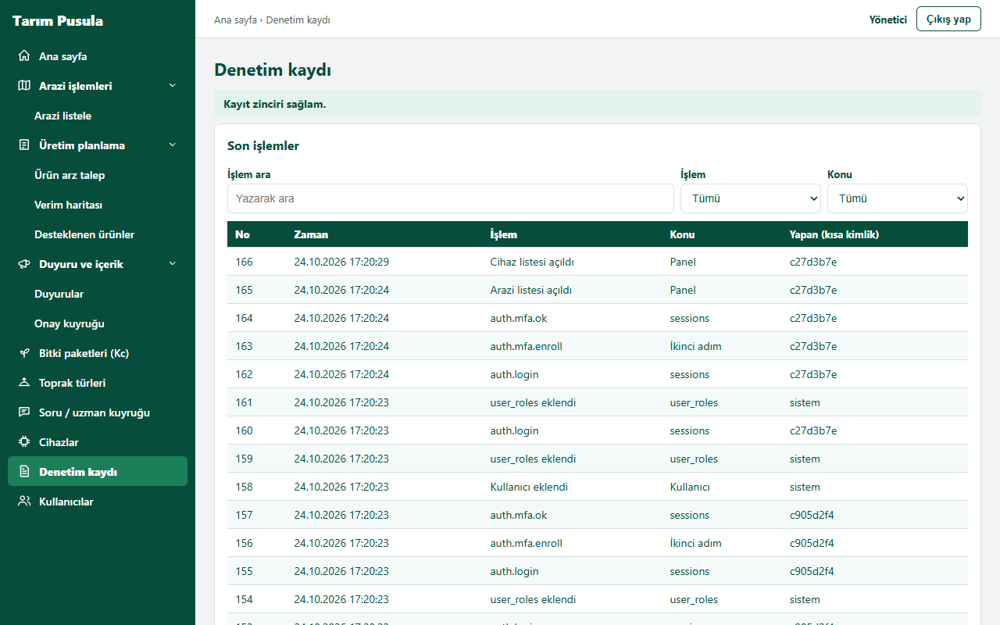 |
| Kullanıcılar | 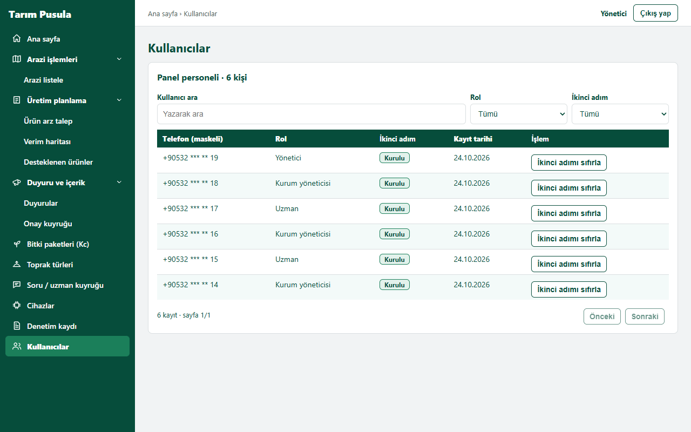 |
